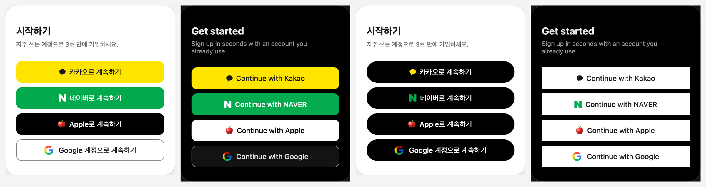

# social-login-buttons

[English](README.md) · [한국어](README.ko.md) · **日本語** · [简体中文](README.zh-CN.md)

Kakao・NAVER・Apple・Google のログインボタンを、各社の公式ブランドガイドラインから実測した値で作ったデザインシステムです。
角丸・色・高さ・文言・言語・レイアウト・テーマを選ぶと、すべてのボタンが同じ形にそろいます。



- **デモ:** https://ai-dico.github.io/social-login-buttons/
- **実測値と出典(韓国語):** [docs/research/official-guides-2026-11-05.md](docs/research/official-guides-2026-11-05.md)
- **決定記録(韓国語):** [docs/decisions-2026-11-05.md](docs/decisions-2026-11-05.md)

## 使い方 — AI にプロンプトで渡す

1. [デモ](https://ai-dico.github.io/social-login-buttons/)で角丸・色・高さ・文言・レイアウトを選びます。
2. 「対象スタック」を選びます — Flutter・Web(HTML/CSS)・Svelte・React・SwiftUI・Compose・自動。
3. 「AI プロンプトをコピー」を押して、Claude Code・Cursor・Lovable などの AI コーディングツールに貼り付けます。

デモを開かずに標準の見た目で使う場合は、次を貼り付けてください。

```text
私のプロジェクトにソーシャルログインボタン(Kakao → NAVER → Apple → Google)を追加して。スタックはプロジェクトに合わせて。
基準: https://github.com/AI-Dico/social-login-buttons
トークンの正本 https://raw.githubusercontent.com/AI-Dico/social-login-buttons/main/tokens.json を最初に読み、defaults の値に従って。
文言は画面に合わせて選んで(登録画面は signup、ログイン画面は login、両方なら continue)。
ロゴはリポジトリの assets/ のファイルを使い、Apple ロゴは再配布禁止なので場所だけ用意して、入手先を私に教えて。
既にログインボタンがあれば、動作はそのままで見た目だけ変えて。
公式ガイドラインとの違いや tokens.json の問題を見つけたら、最後に Issue の下書きとしてまとめて。
```

## 選べる項目

| 項目 | 選択肢 |
|---|---|
| 角丸 | 各社公式・0・4・8・12・ピル — すべてのボタンに同じ値 |
| ボタンの色 | ブランドカラー・すべて白・すべて黒・カスタム(背景・文字、コントラスト比を表示) |
| ロゴの色 | ブランド・単色 |
| 高さ・文字 | 各社公式・44・48・52・56 / すべて同じ・各社公式 |
| 文言 | 自動(画面に合わせる)・ログイン・続ける・登録 — 韓国語・英語 |
| レイアウト | 縦に全幅・狭い幅・アイコンのみ・メインボタン+アイコン |
| テーマ | ライト・ダーク |

## ファイル

- `tokens.json` — トークンの正本(各社の色・サイズ・文言・ロゴ・オプション)。
- `assets/` — Kakao シンボル・NAVER N(SVG)、Google G(SVG・PNG @1x〜@4x)。Flutter・ネイティブでは Google G の PNG を使います。

## ロゴ

- Kakao・NAVER・Google のロゴは各社の公式配布物から取得しています。
- **Apple ロゴは含みません。** Apple Design Resources のライセンスで再配布が禁止されています。
  [Apple Design Resources](https://developer.apple.com/design/resources/#sign-in-with-apple) から各自ダウンロードしてください。
  - 黒いボタンには White ファイル、白いボタンには Black ファイルをそのまま使います。ファイルに背景の四角形が含まれているため、色を付けるとロゴが四角になります。
  - ファイルを入れるまでは、ロゴなしで文字だけを中央に表示します。デモでは 🍎 の絵文字で代用しています。

## 修正点は Issue で

公式ガイドラインと違う値、tokens.json の誤り、特定のスタックで実装しにくい点を見つけたら、[Issue](https://github.com/AI-Dico/social-login-buttons/issues/new) で知らせてください。画面・スタック・選んだオプション・スクリーンショットを添えていただけると早く直せます。Issue はどの言語で書いても構いません。

## ライセンス

コード・トークン・ドキュメント: [MIT](LICENSE)。`assets/` のロゴは各社の商標で MIT の対象外です — 各社のブランドガイドラインに従ってください。

## 商標

Kakao、NAVER、Apple、Google および各ロゴは、それぞれの所有者の商標です。このプロジェクトは各社と提携していません。ボタンは各社のブランドガイドラインに従うよう作られています。
