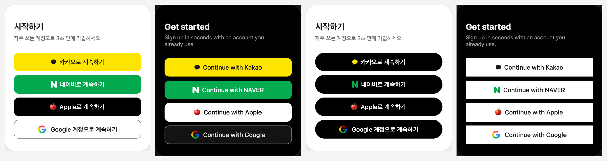

# social-login-buttons

[English](README.md) · **한국어** · [日本語](README.ja.md) · [简体中文](README.zh-CN.md)

카카오 · 네이버 · Apple · Google 로그인 버튼을 각 회사 공식 가이드에서 잰 값으로 그린 디자인 시스템.
모서리 · 색 · 높이 · 문구 · 언어 · 형태 · 테마를 골라 모든 버튼을 같은 모양으로 맞춘다.



- **데모:** https://ai-dico.github.io/social-login-buttons/
- **실측 값과 출처:** [docs/research/official-guides-2026-11-05.md](docs/research/official-guides-2026-11-05.md)
- **결정 기록:** [docs/decisions-2026-11-05.md](docs/decisions-2026-11-05.md)

## 쓰는 법 — AI 에게 프롬프트로

1. [데모](https://ai-dico.github.io/social-login-buttons/)에서 모서리 · 색 · 높이 · 문구 · 형태를 고른다.
2. 「대상 스택」을 고른다 — Flutter · 웹(HTML/CSS) · Svelte · React · SwiftUI · Compose · 자동.
3. 「AI 프롬프트 복사」를 눌러 Claude Code · Cursor · Lovable 같은 AI 코딩 도구에 붙여 넣는다.

데모를 거치지 않고 기본 모양으로 바로 쓰려면 아래를 붙여 넣는다.

```text
내 프로젝트에 소셜 로그인 버튼(카카오 → 네이버 → Apple → Google)을 넣어줘. 스택은 내 프로젝트에 맞게.
기준: https://github.com/AI-Dico/social-login-buttons
토큰 정본: https://raw.githubusercontent.com/AI-Dico/social-login-buttons/main/tokens.json 을 먼저 읽고 defaults 값을 따라줘.
문구는 화면에 맞게 골라줘(가입 화면은 signup, 로그인 화면은 login, 둘 다면 continue).
로고: 저장소 assets/ 의 파일을 쓰고, Apple 로고는 재배포 금지라 자리만 만들어 두고 받는 곳을 나에게 알려줘.
이미 로그인 버튼이 있으면 동작은 그대로 두고 모양만 바꿔.
적용하다 공식 가이드와 다른 점이나 tokens.json 문제를 찾으면 마지막에 이슈 초안으로 정리해줘.
```

## 고를 수 있는 것

| 항목 | 선택지 |
|---|---|
| 모서리 | 회사별 공식 · 0 · 4 · 8 · 12 · 알약 — 모든 버튼에 똑같이 적용 |
| 버튼 색 | 브랜드색 · 모두 흰색 · 모두 검정 · 직접 지정(배경 · 글자, 대비율 표시) |
| 로고 색 | 브랜드 · 단색 |
| 높이 · 글자 | 회사별 공식 · 44 · 48 · 52 · 56 / 모두 같게 · 회사별 공식 |
| 문구 | 자동(화면에 맞게) · 로그인 · 계속하기 · 가입 — 한국어 · English |
| 형태 | 세로 전체 폭 · 좁은 폭 · 아이콘만 · 주 버튼 + 아이콘 |
| 테마 | 라이트 · 다크 |

## 파일

- `tokens.json` — 토큰 정본(회사별 색 · 크기 · 문구 · 로고 · 옵션).
- `assets/` — 카카오 심볼 · 네이버 N(SVG), Google G(SVG · PNG @1x~@4x). Flutter · 네이티브는 Google G PNG 를 쓴다.

## 로고

- 카카오 · 네이버 · Google 로고는 각 회사 공식 배포 자료에서 가져왔다.
- **Apple 로고는 포함하지 않는다.** Apple Design Resources 라이선스가 재배포를 금지한다.
  [Apple Design Resources](https://developer.apple.com/design/resources/#sign-in-with-apple) 에서 직접 받아 넣는다.
  - 검정 버튼에는 White 파일, 흰 버튼에는 Black 파일을 그대로 쓴다. 파일에 배경 사각형이 있어서 색을 입히면 네모가 된다.
  - 파일을 넣기 전에는 로고 없이 글자만 가운데 둔다. 데모에서는 🍎 이모지로 대신 보인다.

## 고칠 점은 이슈로

공식 가이드와 다른 값, tokens.json 오류, 특정 스택에서 구현이 어려운 점을 찾으면 [이슈](https://github.com/AI-Dico/social-login-buttons/issues/new)로 알려 주세요. 화면 · 스택 · 고른 옵션 · 스크린샷을 함께 적어 주면 빠르게 고칠 수 있습니다. 이슈는 어느 언어로 써도 됩니다.

## 상표

Kakao, NAVER, Apple, Google 및 각 로고는 해당 회사의 상표다. 이 저장소는 각 회사와 관련이 없으며, 버튼은 각 회사 브랜드 가이드를 따르도록 만들었다.
