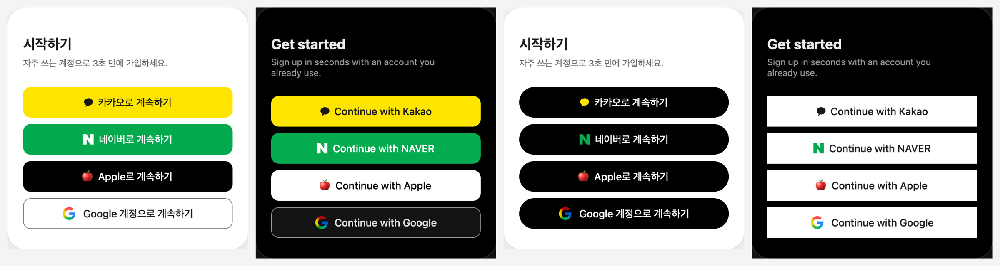

# social-login-buttons

**English** · [한국어](README.ko.md) · [日本語](README.ja.md) · [简体中文](README.zh-CN.md)

A design system for Kakao, NAVER, Apple and Google sign-in buttons, built from values measured against each company's official brand guidelines.
Pick the corner radius, color, height, label, language, layout and theme, and every button follows the same shape.



- **Demo:** https://ai-dico.github.io/social-login-buttons/
- **Measured values and sources (Korean):** [docs/research/official-guides-2026-11-05.md](docs/research/official-guides-2026-11-05.md)
- **Decision log (Korean):** [docs/decisions-2026-11-05.md](docs/decisions-2026-11-05.md)

## How to use — hand a prompt to your AI

1. In the [demo](https://ai-dico.github.io/social-login-buttons/), choose corner radius, color, height, label and layout.
2. Choose a **target stack** — Flutter · Web (HTML/CSS) · Svelte · React · SwiftUI · Compose · Auto.
3. Click **Copy AI prompt** and paste it into an AI coding tool such as Claude Code, Cursor or Lovable.

To use the default look without opening the demo, paste this:

```text
Add social sign-in buttons (Kakao → NAVER → Apple → Google) to my project, using my project's stack.
Reference: https://github.com/AI-Dico/social-login-buttons
Read the token source of truth first: https://raw.githubusercontent.com/AI-Dico/social-login-buttons/main/tokens.json and follow its defaults.
Pick labels that fit the screen (signup screen → signup, sign-in screen → login, both → continue).
Logos: use the files in the repo's assets/. The Apple logo cannot be redistributed, so leave a slot for it and tell me where to download it.
If sign-in buttons already exist, keep their behavior and change only the appearance.
If you find anything that differs from the official guidelines or a problem in tokens.json, list it at the end as an issue draft.
```

## Options

| Option | Choices |
|---|---|
| Corner radius | Per-company official · 0 · 4 · 8 · 12 · Pill — applied to every button |
| Button color | Brand · All white · All black · Custom (background · text, with contrast ratio) |
| Logo color | Brand · Mono |
| Height · Text | Per-company official · 44 · 48 · 52 · 56 / Same for all · Per-company official |
| Label | Auto (fits the screen) · Sign in · Continue · Sign up — Korean · English |
| Layout | Full-width stack · Narrow · Icons only · Primary button + icons |
| Theme | Light · Dark |

## Files

- `tokens.json` — token source of truth (colors, sizes, labels, logos, options per company).
- `assets/` — Kakao symbol and NAVER N (SVG), Google G (SVG and PNG @1x–@4x). Use the Google G PNG on Flutter and native platforms.

## Logos

- The Kakao, NAVER and Google logos come from each company's official distribution.
- **The Apple logo is not included.** The Apple Design Resources license forbids redistribution.
  Download it yourself from [Apple Design Resources](https://developer.apple.com/design/resources/#sign-in-with-apple).
  - Use the White file on black buttons and the Black file on white buttons, as is. The files contain a background rectangle, so tinting them turns the logo into a solid box.
  - Until the file is added, show the label alone, centered. The demo shows a 🍎 emoji in its place.

## Report fixes as issues

If you find a value that differs from the official guidelines, an error in tokens.json, or something hard to implement on a particular stack, please [open an issue](https://github.com/AI-Dico/social-login-buttons/issues/new). Include the screen, stack, chosen options and a screenshot. Issues are welcome in any language.

## License

Code, tokens and docs: [MIT](LICENSE). Logos in `assets/` are trademarks of their owners and are not covered by the MIT license — follow each company's brand guidelines.

## Trademarks

Kakao, NAVER, Apple, Google and their logos are trademarks of their respective owners. This project is not affiliated with any of these companies; the buttons are built to follow each company's brand guidelines.
