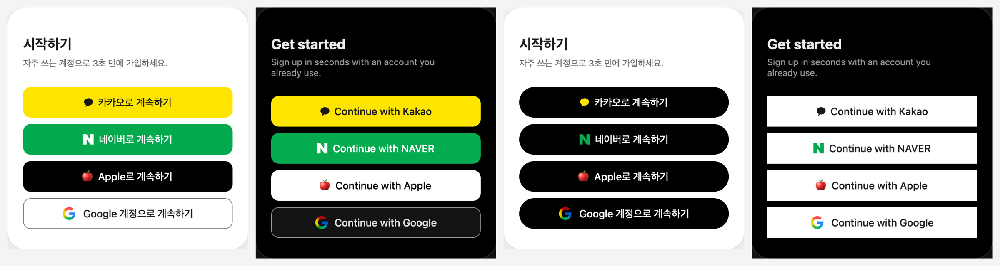

# social-login-buttons

[English](README.md) · [한국어](README.ko.md) · [日本語](README.ja.md) · **简体中文**

Kakao、NAVER、Apple、Google 登录按钮的设计系统,所有数值均依据各公司官方品牌指南实测得出。
选择圆角、颜色、高度、文案、语言、布局和主题后,所有按钮都会保持同样的外观。



- **演示:** https://ai-dico.github.io/social-login-buttons/
- **实测数值与出处(韩语):** [docs/research/official-guides-2026-11-05.md](docs/research/official-guides-2026-11-05.md)
- **决策记录(韩语):** [docs/decisions-2026-11-05.md](docs/decisions-2026-11-05.md)

## 使用方法 — 把提示词交给 AI

1. 在[演示页面](https://ai-dico.github.io/social-login-buttons/)选择圆角、颜色、高度、文案和布局。
2. 选择「目标技术栈」— Flutter · Web(HTML/CSS)· Svelte · React · SwiftUI · Compose · 自动。
3. 点击「复制 AI 提示词」,粘贴到 Claude Code、Cursor、Lovable 等 AI 编程工具中。

如果不打开演示页面、直接使用默认样式,请粘贴以下内容:

```text
在我的项目中添加社交登录按钮(Kakao → NAVER → Apple → Google),技术栈与我的项目保持一致。
参考:https://github.com/AI-Dico/social-login-buttons
请先读取令牌唯一来源 https://raw.githubusercontent.com/AI-Dico/social-login-buttons/main/tokens.json,并按照其中的 defaults。
文案请根据页面选择(注册页用 signup,登录页用 login,两者兼有用 continue)。
Logo 使用仓库 assets/ 中的文件;Apple Logo 禁止再分发,请只预留位置,并告诉我从哪里下载。
如果已有登录按钮,请保留原有行为,只修改外观。
如果发现与官方指南不一致的地方或 tokens.json 的问题,请在最后整理成 Issue 草稿。
```

## 可选项

| 项目 | 选项 |
|---|---|
| 圆角 | 各公司官方 · 0 · 4 · 8 · 12 · 胶囊 — 所有按钮使用同一数值 |
| 按钮颜色 | 品牌色 · 全白 · 全黑 · 自定义(背景、文字,显示对比度) |
| Logo 颜色 | 品牌色 · 单色 |
| 高度 · 文字 | 各公司官方 · 44 · 48 · 52 · 56 / 全部相同 · 各公司官方 |
| 文案 | 自动(根据页面)· 登录 · 继续 · 注册 — 韩语 · 英语 |
| 布局 | 纵向全宽 · 窄宽 · 仅图标 · 主按钮 + 图标 |
| 主题 | 浅色 · 深色 |

## 文件

- `tokens.json` — 令牌唯一来源(各公司的颜色、尺寸、文案、Logo、选项)。
- `assets/` — Kakao 符号、NAVER N(SVG),Google G(SVG、PNG @1x–@4x)。Flutter 和原生平台请使用 Google G 的 PNG。

## Logo

- Kakao、NAVER、Google 的 Logo 取自各公司的官方发布资源。
- **不包含 Apple Logo。** Apple Design Resources 许可禁止再分发。
  请自行从 [Apple Design Resources](https://developer.apple.com/design/resources/#sign-in-with-apple) 下载。
  - 黑色按钮使用 White 文件,白色按钮使用 Black 文件,直接使用即可。文件中带有背景矩形,着色后 Logo 会变成方块。
  - 放入文件之前,只将文字居中显示,不显示 Logo。演示页面用 🍎 表情代替。

## 问题请提交 Issue

如果发现与官方指南不一致的数值、tokens.json 的错误,或在某个技术栈上难以实现的地方,请[提交 Issue](https://github.com/AI-Dico/social-login-buttons/issues/new)。附上页面、技术栈、所选选项和截图,我们能更快修复。Issue 可以用任何语言撰写。

## 许可证

代码、令牌和文档:[MIT](LICENSE)。`assets/` 中的 Logo 是各公司的商标,不在 MIT 许可范围内 — 请遵循各公司的品牌指南。

## 商标

Kakao、NAVER、Apple、Google 及其 Logo 均为各自所有者的商标。本项目与上述公司无关联;按钮按照各公司的品牌指南制作。
